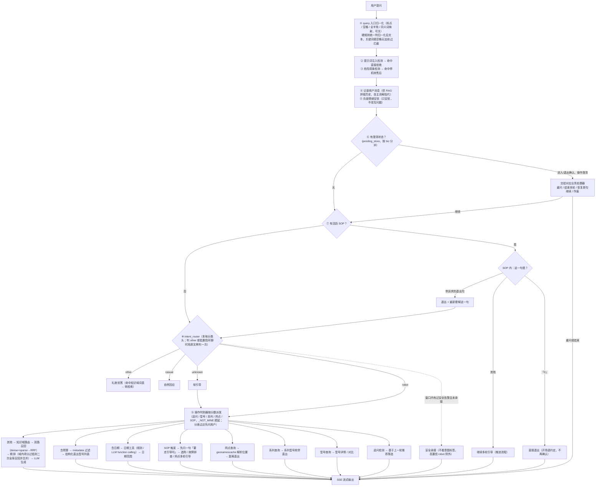

# 扫地机器人智能客服（clean_robot_agent）

基于 **RAG（检索增强生成）** 与 **本地大模型** 的扫地机器人智能客服系统。支持自然语言问答、预算内产品推荐、故障排查、使用维护等场景，全部模型本地化部署，无需云端 API。

## 核心特性

- **双路召回 + 精排**：稠密检索（bge-m3 向量）+ 稀疏检索（BM25 关键词）→ RRF 融合 → Cross-Encoder 精排，兼顾语义近似、精确关键词匹配与长尾噪声压制
- **域定向召回的两遍机制**：进了知识域但域内得分整体过低时，自动撤掉域过滤再召回一次全库，两池按分数限额合并——避免“域路由选错文件→一条都召不回”，同时不让兜底结果把高置信的域内结果挤掉
- **意图分类**：本地深度学习分类头（bge-m3 embedding + Linear 分类器）前置判断用户意图，毫秒级推理
- **query 入口归一化**：进链路先做纯规则清洗（标点、空格、全半角、同义词映射如「扫托→扫拖」，也兼容型号名不带空格的写法「云顶X2」）；清洗后的文本用于**硬规则（注入/危险/退出/「0」）**、SOP 触发、操作判别、域路由与检索，**判到领域外或低置信闲聊时会拿原文再判一次**，两遍里任一遍判域内就按域内走（宁可多检索一轮，也不误拒答）；原文仍用于生成与对话记录，整条链路可用开关一键关闭
- **结构化查询**：识别"预算 1000 以内""净白 S 系列"等约束，通过 Chroma metadata 过滤精确枚举预算内/系列内产品；支持"云顶 X2 多少钱"等型号属性精准查询；型号名**精确优先**（问"P2"不会连带返回 P2 Lite / P2 Pro，系列名仍可多命中）
- **操作判别与澄清**：用关键句 + 稠密/BM25 双路召回给 8 类操作（追问 / 型号 / 系列 / 网点 / SOP / 日期 / 筛选 / 知识问答）打分，先过分数阈值、再看词表命中；前两名分差过近时问用户选 1/2，按选择重放原问题
- **工具调用**：LLM function calling，内置日期/预算/故障分类/型号提取/售后网点五个工具，支持"最近半年""一千来块"等口语化结构化提取；预算同时识别"2000吧"这类语气词尾音
- **多轮 SOP 引导**：选购推荐、故障排查等场景按标准流程多轮引导，进入时给开场提示；**所有 SOP 进入前先问一句是否要走引导**（进入确认门，SOP 自己声明 `enter_confirm`，默认 `always`；网点查询同样先问），流程内说退出也要先确认（退出确认门）；**拒绝引导后会在答案前补一句「之后怎么再进」**（举的是强触发说法）；同会话拒绝过该 SOP 后，泛问不再问门、强触发仍可直接进；支持追问（比较新/更便宜/最贵）与最近发布查询；**「重新回答」按上一轮出口决定重算**——上一轮是 SOP 收尾轮就重开该流程（重开同样先过确认门），SOP 中途不给重发；重答按**覆盖上一轮**处理，同一句不会在历史里落两遍、也不留两版回答。槽位收口语短答（预算「800」按上限、宠物「不」/「没」算没有）；筛出 0 款时给"预算内暂时没有 + 下一步"的成品话术，**不点型号与价格**（型号与价格只允许来自知识库原文）
- **售后网点定位**：识别"最近的售后网点"等查询，通过 geonamescache 离线解析城市经纬度 + Haversine 距离排序返回最近网点，重名城市（如"洛阳"）多轮消歧（走 SOP 状态机：先问城市，重名再问一次序号）
- **Redis 可选接入**：SOP 会话状态、**澄清状态**、会话并发锁、热更新摄入锁迁移到 Redis（分布式锁/跨实例共享），未配置 Redis 时自动降级到本地内存，功能不受影响（降级的内存态同样按 TTL 过期，不会永远不失效）
- **知识库分域**：按场景（品牌/选购/型号/故障/售后/维护/操作 7 域）定向检索对应知识域（型号类问题走结构化直出、不靠域过滤），避免跨域词带偏召回
- **品牌化**：全面转型"不染一尘"品牌专属客服；品牌咨询、售后咨询走 RAG 直答，安全危险现象前置拦截（除书面词外，也包含火星、焦味、噼啪等**口语同义表达**），且告警后的追问会被拉回安全话题（**不看意图分类结果**，只有高置信的域内问题才放行）；公司 / 招聘类问题一律礼貌回避、不编造信息
- **情绪安抚**：识别负面情绪（投诉/烦躁等）前置安抚，只安抚、不拦截也不改写问题
- **流式输出**：SSE 流式返回答案，前端逐字渲染
- **知识库热更新**：每 30 分钟自动扫描 `data/knowledge/`，检测文件增删改并增量入库；每次同步后记一行「当前知识库版本」（逐文件 sha256 + chunk 数）到 `data/state/kb_metadata.jsonl`，可当版本历史，评测环境核对也读它（热更新线程随 `python webapp/app.py` 启动；改用 WSGI 部署需自行起线程）
- **多轮友好**：领域外问题礼貌拒答；判成 other 但**能命中知识域词表**的不拒答、交给检索（无主语域内问句容易被分类头判偏，靠这层兜住）；模糊问题软引导，闲聊自然回应
- **低置信追问承接**：追问句的指代在上文时分类头会判不准；命中「低置信或判成闲聊 + 上文有可承接话题」就不硬拒答——安全话题（冒烟/漏电/火星/焦味等）直接承接并复述处理方式，其余先用上文改写 query 再检索；检索确实无果时给兜底话术，不凭自身知识作答
- **多会话与上下文**：按会话（session_id）隔离多轮对话，对话持久化到本地（jsonl + meta），支持新建/切换/删除历史会话，首轮回答后自动生成 LLM 语义标题与更新时间；自由指代通过拼接历史由 LLM 自主消解
- **回复评价（标注回流）**：每条机器人回复下方可点「👍 有用 / 👎 无用」；无用需选一个原因（没找到/召回错、知识库没有、答非所问、答错了、答得不全、太啰嗦/格式乱、其他），可再补一句说明。原因按「第一个出错的环节」收敛、各带归因层，标注按 query 定位到轮次，与该轮的召回片段、行为标签一起落 trace，可直接聚类成 badcase 与修复项；**标错了可以改**（重新标注以最后一次为准，历史保留、不覆盖）

## 技术栈

| 层 | 技术 |
|----|------|
| 前端 | Flask + 原生 HTML/CSS/JS |
| 检索 | Chroma（向量库）+ BM25（rank-bm25）+ RRF 融合 + bge-reranker-v2-m3 精排 |
| Embedding | bge-m3（本地 Ollama） |
| 生成模型 | qwen2.5:7b（本地 Ollama） |
| 意图分类 | bge-m3 + PyTorch 分类头（本地推理） |
| 文档解析 | pypdf + Docling + 标准库多策略 |

## 目录结构

```
clean_robot_agent/
├── config/                      # 配置文件（实际配置 + _template 模板）
│   ├── agent.yaml               # Agent/LLM 配置（含模型名、温度）
│   ├── rag.yaml                 # RAG 配置（分块、检索、RRF 参数）
│   ├── chroma.yaml              # Chroma/embedding 配置
│   ├── prompts.yaml             # Prompt 文件路径
│   ├── context.yaml             # 上下文承接与查询改写（低置信阈值、改写开关）
│   ├── redis.yaml               # Redis 连接与各 TTL（可选，缺失即走本地内存降级）
│   ├── word_dict_config.py      # 词表配置中心（情绪/退出/域/触发/症状/型号系列/词表型正则/固定话术等集中管理）
│   └── *_template.yaml          # 对应模板（含注释说明，复制后填值）
├── data/
│   ├── knowledge/               # 知识库源文件（txt/pdf，热更新监控目录）
│   ├── knowledge_example/       # 知识库格式模板示例
│   ├── datasets/                # 意图分类训练数据集（JSONL）
│   ├── context/                 # 对话上下文持久化（jsonl，按会话创建日期分子目录：<YYYYMMDD>/）
│   ├── service_point/           # 售后网点数据（网点清单，城市坐标由 geonamescache 提供）
│   ├── bgm_model/               # 训练好的分类头模型
│   ├── pkl/                     # BM25 pickle 缓存
│   ├── state/                   # 热更新 sha256 快照 + kb_metadata.jsonl（知识库版本记录）
│   ├── vector_store/            # Chroma 持久化向量库
│   └── eval/                    # 评测集与基线：retrieval/ 单轮检索 · context/ 多轮行为 · intent/ 意图分类（本地数据，已 gitignore）
├── prompts/                     # Prompt 模板（system/摘要/报告）
├── tools/                       # 核心工具模块（详见下节）
├── function_tools/              # LLM 工具调用（function calling）工具
│   ├── date_tool.py             # 日期计算工具（绝对/相对日期 → 日期范围）
│   ├── budget_tool.py           # 预算提取工具（规则 miss 时 function calling 兜底）
│   ├── symptom_tool.py          # 故障现象分类工具（规则 miss 时 function calling 兜底）
│   ├── model_tool.py            # 型号工具：提取型号名 + find_models 按预算/参数/排序筛选型号
│   ├── kb_tool.py               # 知识库检索工具（search_kb：自足检索式 + 可选知识域）
│   ├── service_point_tool.py    # 售后网点工具（geonamescache 离线解析城市 + Haversine 距离）
│   └── registry.py              # 工具注册中心（对外暴露的工具白名单 + 编排开关读取）
├── sops/                        # SOP 标准操作流程（多轮引导）
│   ├── base.py                  # 会话状态（按 session_id 隔离，带定义指纹）+ 执行器 + 知识域定义
│   ├── purchase.py              # 选购推荐 SOP
│   ├── repair.py                # 故障排查 SOP
│   └── service_point.py         # 售后网点 SOP（问城市 → 重名选序号）
├── test_scripts/                # 测试与评测（run_tests.py 只聚合 eval/ 评测轨；unit/ 功能测试可单独运行）
│   ├── run_tests.py             # 评测入口：python run_tests.py --e2e
│   ├── _runner.py               # 共享断言/汇总/e2e 门控/测试数据隔离
│   ├── trace_reader.py          # trace 读取层（文本视图与 HTML 报告共用）
│   ├── trace_report.py          # 读 trace：按会话列出每轮走向（--list/--session/--chunks/--shadow/--feedback）；--html 出 HTML 报告（落 reports/<日期>/）
│   ├── unit/                    # 功能测试（不进评测入口，文件可单独运行）
│   │   ├── test_purchase_sop.py # 选购 SOP（SOP 状态机 + 选购推荐流程）
│   │   ├── test_repair_sop.py   # 故障排查 SOP（症状映射 + 流程）
│   │   ├── test_context.py      # 上下文存储（append/get_recent/meta/UUID 校验）
│   │   ├── test_metadata.py     # 结构化提取（价格/日期/型号/系列/过滤）
│   │   ├── test_function_tools.py  # 日期/预算/型号/症状/网点五个工具
│   │   ├── test_retrieval.py    # 检索链路（域路由/分词/过滤/RRF/阈值/精排/条目切分）
│   │   ├── test_agent_guards.py # Agent 前置防护（情绪/注入/危险/退出意图/域外拒答门）
│   │   ├── test_operations.py   # 操作判别器（注册表形状/入口判据/三态出口/打分与三段过滤）
│   │   ├── test_pending_store.py # 澄清状态存储（业务 id 隔离 / 重试 / 过期 / 重建）
│   │   ├── test_query_normalizer.py # query 入口归一化（标点/空格/全半角/同义词/幂等）
│   │   ├── test_hot_ingest.py   # 知识库热更新（增量同步的删除/重入语义）
│   │   ├── test_service_point_sop.py # 网点 SOP（城市解析 / 重名选序号）
│   │   ├── test_trace_report_html.py # trace HTML 报告（数据整形 / 渲染 / 边界）
│   │   ├── test_review_fixes.py # 代码 review 修复回归（依赖降级 / 日期闸门 / 上传净化 / 重答与历史口径）
│   │   ├── test_webapp_routes.py # webapp 路由层契约（入参校验 / 状态码 / 并发锁拒绝）
│   │   └── test_dialogue.py     # 多轮实战对话（正常 + 非人类，需 --e2e）
│   └── eval/                    # 评测轨（留出集 + 基线，评测入口默认跑这些；多数需 --e2e）
│       ├── test_behavior_tags.py   # 行为闭集（branch）与 trace 记录契约自检（纯规则，不依赖模型）
│       ├── test_retrieval_eval.py  # 检索质量评测（hit@k/MRR；评测集 data/eval/retrieval）
│       ├── test_context_eval.py    # 多轮行为评测（按 trace 的 branch 判出口行为；评测集 data/eval/context）
│       └── test_intent_eval.py     # 意图分类评测（留出集；口径见 data/datasets/README.md）
├── intent_classifier_training/  # 意图分类模型训练工具
│   ├── build_intent_dataset.py  # 数据集构建（从知识库抽取 + 规则改写）
│   └── train_intent_classifier.py # 分类头训练脚本
├── webapp/
│   ├── app.py                   # Flask 后端（上传/问答/流式接口 + 会话 API）
│   ├── templates/index.html     # 聊天前端（新建/历史对话）
│   └── static/vendor            # 前端第三方库（marked 等，随仓库提交）
├── requirements.txt
└── .gitignore
```

> `temp/`（数据处理脚本；页面上传的临时文件落 `temp/uploads`，摄入完即删）、`Multi_Route_Retrieval/`（双路召回 demo）为独立用途遗留目录，已 gitignore，不参与运行。

## 核心模块说明（tools）

| 模块 | 职责 |
|------|------|
| `agent.py` | RAG 编排：意图路由 → 知识域路由 → 检索 → 结构化直出或 LLM 生成 |
| `operations.py` | 操作判别器：把"这一轮算哪个操作"（追问 / 型号 / 系列 / 售后网点 / SOP 触发）从编排的 if 链里抽出来，变成可断言、可留痕的一次判定。8 个操作各配一组**关键句**，用稠密 + BM25 双路打分，主链路按**三段过滤**派发：分数过 `floor` → 词表/结构判据命中 → 前两名分差小于 `gap` 时问用户选哪个；判定与分数落 trace 的 `route.ops` |
| `intent_router.py` | 意图分类：本地分类头（bge-m3 + Linear）判 robot/casual/other/unknown |
| `query_normalizer.py` | query 入口归一化（纯规则、幂等）：标点 / 空格 / 全半角 / 同义词映射 |
| `orchestrator.py` | 工具编排：让模型在工具白名单里做一次决策（选工具 + 填参数），**只出决策、不执行工具**；影子模式用于与现有链路对照并打日志 |
| `hybrid_retriever.py` | 召回编排：dense + sparse → RRF 融合 → 精排 →（域内 top1 不过阈值时）撤域过滤二次全库召回 + 两池限额合并 → 截断 |
| `vector_store.py` | Chroma 稠密检索、入库、metadata 过滤、稀疏索引构建 |
| `sparse_retriever.py` | BM25 关键词检索（含 pickle 持久化缓存） |
| `rrf_fusion.py` | RRF（倒数排名融合）算法 |
| `reranker.py` | Cross-Encoder 精排（bge-reranker-v2-m3，本地推理；不可用时降级回 RRF 顺序）|
| `metadata_extractor.py` | 结构化元数据：价格提取、预算解析、发布时间提取、型号信息抽取 |
| `entry_splitter.py` | 编号条目分块器（每个问答/型号一个 chunk） |
| `hot_ingest.py` | 知识库热更新：定时扫描 + 增量入库 |
| `file_tools.py` | 文档多策略解析（txt/pdf/csv/docx） |
| `llm_tool.py` | LLM / embedding 工厂（含 function calling） |
| `log_tool.py` | 日志（控制台彩色 + 文件，按 `logs/<模块>/<日期>/` 分目录；行上带会话标记，可按会话 grep） |
| `config_tool.py` / `path_tool.py` / `prompts_tool.py` | 配置 / 路径 / Prompt 加载 |
| `context_store.py` | 会话上下文：按 session_id 持久化对话（jsonl 保留**全量**，内存与读取窗口为最近 6 轮）+ meta 元数据（LLM 标题）+ 会话增删查改 |
| `redis_store.py` | Redis 连接封装 + 互斥锁（SET NX）+ 降级回退：无 Redis 时自动回退本地内存 |
| `pending_store.py` | 统一澄清状态（SOP 进入/退出确认、操作澄清共用）：Redis `clarify:{sid}` + `clarify_ttl`（≥ `sop_ttl`），记录 `{biz, retry, state, data}`（`state` = 业务快照，如 SOP 的 step/slots），业务 id 隔离（`sop.enter` / `sop.exit` / `ops.clarify`），无 Redis 降级内存并校验时间戳；只存状态，不解析回答 |
| `test_hooks.py` | **仅供测试/评测**的状态注入助手（danger 窗口 / 连续承接计数 / 活跃 SOP / 澄清状态）|
| `trace_store.py` | 会话级 trace：每轮落一条结构化记录（`logs/trace/<日期>/<会话ID>_<日期>_<时间>/<同名>.jsonl`，先按日期分目录再按会话，best-effort 不影响对话，`TRACE_DIR` 可改落点）；记录与执行同构：进门判断、本轮唯一出口、有序节点（含状态/耗时/进出事实）、两遍召回与各遍计数、最终候选的来源分布、SOP 动作链，另保留旧字段作兼容；同一会话目录下另有三份旁路文件：召回片段全文、影子决策、用户评价 |

> trace 读侧是一个脚本 `test_scripts/trace_report.py`：文本视图按会话列出每轮走向（`--chunks/--shadow/--feedback` 看旁路证据）；
> 加 `--html` 则把某天渲染成一份自包含 HTML 报告（落 `reports/<日期>/`，`--out-dir` 换根目录、`--out` 给整路径）。

## 工具调用模块（function_tools/）

| 模块 | 职责 |
|------|------|
| `date_tool.py` | 日期计算工具：`calc_date_range` 把"最近半年""2025年三月"等表达换算成日期范围 |
| `budget_tool.py` | 预算提取工具：规则 miss 时用 3b function calling 提取预算上限（"一千来块"等） |
| `symptom_tool.py` | 故障分类工具：规则 miss 时用 3b function calling 归类口语故障（"奇怪的声音"等） |
| `model_tool.py` | 型号工具：7b function calling 提取型号名（含上下文指代）后精准检索详情；`find_models` 支持按预算（传原话，规则解析方向与浮动）/ 规格参数 / 排序（规格、「参考价」、「发布时间」）/ **筛选范围（全库 / 上一轮推荐内 / 比上一轮更便宜·更贵·更新·更旧，可组合）** 筛选型号，并带参数校验（按用户原话纠正方向、剔除无效条件） |
| `service_point_tool.py` | 售后网点工具：geonamescache 离线解析城市经纬度（中文名/重名候选）+ Haversine 距离排序 + 网点格式化 |
| `kb_tool.py` | 知识库检索工具：`search_kb` 接自足检索式 + 可选知识域（域为软约束，域内置信度低时检索器会撤过滤并合并全库结果） |
| `registry.py` | 工具注册中心：收敛对外暴露的工具白名单（型号筛选 / 知识库检索 / 售后网点），未知工具名直接报错 |

## SOP 模块（sops/）

| 模块 | 职责 |
|------|------|
| `base.py` | SOP 基础设施：会话状态 + 执行器（ask/action/reply 三步式状态机）+ 知识域定义（DOMAIN_MAP）+ 追问处理（比较新/更便宜）+ 最近发布查询。**会话状态带定义指纹**：代码改过 SOP 定义后，Redis 里的旧会话读时自动作废（不会拿旧下标续跑）；无 Redis 降级的内存态同样按 TTL 过期 |
| `purchase.py` | 选购推荐 SOP：收集预算（上限/下限/区间/浮动）+ 宠物 → 结构化推荐 |
| `repair.py` | 故障排查 SOP：问现象 → 检索 → LLM 生成排查步骤 |

## 快速开始

### 1. 环境要求

- Python 3.13（开发环境实测；仓库未声明版本约束文件）
- [Ollama](https://ollama.com)（本地已运行）
- 内存 ≥ 20GB（Ollama 三模型常驻：bge-m3 + qwen2.5:3b + qwen2.5:7b；精排模型再占约 2.2GB，不需要时可用 `rag.yaml` 的 `rerank.enabled: false` 省下）

### 2. 安装依赖

```bash
pip install -r requirements.txt
```

### 3. 拉取模型

**Ollama 模型**（embedding + 生成 + 兜底）：

```bash
ollama pull bge-m3        # embedding 模型
ollama pull qwen2.5:7b    # 生成模型 + 型号提取（function calling）
ollama pull qwen2.5:3b    # 预算/故障现象 function calling 兜底（可选）
```

**精排模型 `bge-reranker-v2-m3`**（约 2.2GB）：它不是 Ollama 模型——Ollama 没有 rerank 端点，
由 `tools/reranker.py` 走 transformers 本地推理，**首次检索时自动从 HuggingFace 下载并缓存**，
无需手动执行命令。国内网络慢可先设镜像再启动：

```bash
export HF_ENDPOINT=https://hf-mirror.com
# PowerShell: $env:HF_ENDPOINT="https://hf-mirror.com"
```

也可提前手动下载：

```bash
python -c "from huggingface_hub import snapshot_download; snapshot_download('BAAI/bge-reranker-v2-m3')"
```

加载时**优先只用本地缓存**（避免每次启动都卡在联网校验上），缓存未命中才联网；加载失败会记
WARNING 并降级为「不精排」，功能不受影响。需要换用其它 reranker 时改 `rag.yaml` 的 `rerank.model`。

### 4. 配置

复制模板为实际配置，填入你的参数：

```bash
cp config/agent_template.yaml  config/agent.yaml
cp config/rag_template.yaml    config/rag.yaml
cp config/chroma_template.yaml config/chroma.yaml
cp config/prompts_template.yaml config/prompts.yaml
cp config/context_template.yaml config/context.yaml
# 可选：接 Redis（不接则相关状态自动降级本地内存）
cp config/redis_template.yaml  config/redis.yaml
```

### 5. 训练意图分类头（首次必需）

意图分类头（`data/bgm_model/`）是**训练产物、已 gitignore**，仓库里不包含，
**首次运行前必须先训练**，否则启动后首次提问会报错（找不到分类头文件）。
训练数据集 `data/datasets/intent_dataset.jsonl` 已随仓库提供，直接训练即可：

```bash
python intent_classifier_training/train_intent_classifier.py
```

训练会用 Ollama bge-m3 生成 embedding（需 §3 的模型已就绪），产物输出到 `data/bgm_model/`。
`build_intent_dataset.py` 只用于从知识库重新生成种子样本，**默认写 `data/datasets/_generated.jsonl`**、
不动正式数据集；加 `--force` 才会整份重写 `intent_dataset.jsonl`（会丢人工标注的 `source`，先备份）。
详见下方「意图分类模型训练」。

### 6. 启动

```bash
python webapp/app.py
```

浏览器打开 `http://localhost:5050`。

## 知识库管理

知识库源文件放在 `data/knowledge/` 下，支持 `.txt/.md/.pdf/.csv/.docx/.pptx/.xlsx`。

**文档格式规范**（详见 `data/knowledge_example/格式模板.txt`）：

```
## 入门级（1500 元以下）
1. **米家扫拖机器人 M20**
   - 吸力：2800Pa｜导航：LDS激光｜避障：红外
   - 参考价：899
```

核心规则：
- 每个条目以 `数字. ` 开头
- 型号名/问题用 `**加粗**`
- 参数用 `｜` 分隔，值内不能有空格
- 价格独立一行 `参考价：数字`
- 发布时间独立一行 `发布时间：YYYY-MM-DD`（用于"最近半年""2025年三月"等新品查询）

**热更新**：放入新文件后，系统每 30 分钟自动检测并入库；重启 Flask 会立即触发一次扫描。

**改同一个文件**：把新版本放回 `data/knowledge/`（或走页面上传）即可——重入是**替换**（旧 chunk 会被删掉，不会叠加重复条目），型号缓存与 BM25 索引也跟着重建，直出与检索两边始终一致。

## 意图分类模型训练

系统用**本地分类头**做意图分类（bge-m3 embedding + Linear 1024→4），毫秒级、不调 LLM；
分类头文件缺失或不可用时**显式降级**（WARNING + 全部判 unknown，走软引导 + RAG），服务不会崩；
但正常作答质量依赖它，**首次运行前必须先训练一次**（见「快速开始 §5」）。

**重新训练**（当需要扩充数据集时）：

```bash
# 1. 扩充数据集：往 data/datasets/intent_dataset.jsonl **追加**样本
#    （字段与标注口径见 data/datasets/README.md）
#    ⚠ build_intent_dataset.py 默认写 _generated.jsonl、不动正式数据集；
#      只有显式加 --force 才会整份重写 intent_dataset.jsonl（生成样本无人工 source，覆盖前先备份）

# 2. 训练分类头（bge-m3 embedding + Linear 分类器）
python intent_classifier_training/train_intent_classifier.py
```

训练产物输出到 `data/bgm_model/`，推理时由 `intent_router.py` 自动加载；**重训后需重启服务**才生效。
样本要覆盖两侧边界（补一族正例常把邻族带翻），评测集里出现过的句子不能进训练集——改完跑
`test_scripts/run_tests.py --e2e` 的三条评价轨确认没退化。

## 测试

测试脚本在 `test_scripts/`。**评测入口 `run_tests.py` 只跑 `eval/` 下的数据集评测轨**（检索质量 / 多轮行为 / 意图分类 + 一条纯规则的 tag 契约自检）：

- **评测轨**（`eval/`，默认）：基于留出集与基线，需本地 Ollama + Chroma + 精排模型，**要加 `--e2e`**；
- **单元测试**（`unit/`，**暂搁置**）：纯规则逻辑，快、确定性，不进评测入口；文件都还在，需要时单独运行；
- **数据隔离**：测试产生的会话/上下文文件写入 `data/test_context/`、`data/test_context_metadata/`，不污染真实会话数据。

> 请用项目虚拟环境解释器运行——`torch` 等依赖只装在 `.venv`，系统 Python 没有。

```bash
# 数据集评测轨（需 Ollama + Chroma + reranker）
.venv/Scripts/python.exe test_scripts/run_tests.py --e2e

# 单条评测轨也可独立运行
.venv/Scripts/python.exe test_scripts/eval/test_context_eval.py --e2e
.venv/Scripts/python.exe test_scripts/eval/test_retrieval_eval.py --e2e --compare

# 单元测试（暂搁置）：不进评测入口，按需单独运行
.venv/Scripts/python.exe test_scripts/unit/test_purchase_sop.py
```

### 测试模块

`eval/` 是带留出集与基线的评测轨——**评测入口默认跑这些**：

| 模块 | 覆盖范围 | 需 `--e2e` |
|------|---------|:---------:|
| `eval/test_behavior_tags.py` | 行为观测点 tag 契约自检（采集 / 映射 / 判定四态 / 影子隔离） | |
| `eval/test_retrieval_eval.py` | 检索质量评测（hit@k / MRR / 无召回率 / 结构化直出命中率） | ✓ |
| `eval/test_context_eval.py` | 多轮行为评测（按行为观测 tag 判出口行为 + 回归门禁 + 软行为复核清单） | ✓ |
| `eval/test_intent_eval.py` | 意图分类评测（逐条标签 / 各类 F1 / 混淆矩阵 / 高置信错判） | ✓ |

`unit/` 是功能测试，**暂搁置**（不进评测入口，需要时单独运行）：

| 模块 | 覆盖范围 | 需 `--e2e` |
|------|---------|:---------:|
| `unit/test_purchase_sop.py` | 选购 SOP（状态机 + 选购推荐流程） | |
| `unit/test_repair_sop.py` | 故障排查 SOP（症状映射 + 流程） | |
| `unit/test_context.py` | 上下文存储（消息读写 / meta / UUID 校验 / 会话列表） | |
| `unit/test_metadata.py` | 结构化提取（价格 / 日期 / 型号 / 系列 / 过滤） | |
| `unit/test_function_tools.py` | 日期 / 预算 / 型号 / 症状 / 网点五个工具 | |
| `unit/test_retrieval.py` | 检索链路（域路由 / 分词 / 过滤 / RRF / 阈值 / 精排 / 条目切分） | 部分 |
| `unit/test_agent_guards.py` | Agent 前置防护（情绪 / 注入 / 危险 / 退出意图 / 域外拒答门） | |
| `unit/test_operations.py` | 操作判别器（注册表形状 / 入口判据 / 三态出口 / `route.ops` 落盘） | |
| `unit/test_query_normalizer.py` | query 入口归一化（标点 / 空格 / 全半角 / 同义词 / 幂等） | |
| `unit/test_hot_ingest.py` | 知识库热更新（增量同步的删除/重入语义、缓存失效） | |
| `unit/test_service_point_sop.py` | 网点 SOP（城市解析 / 重名选序号） | |
| `unit/test_trace_report_html.py` | trace HTML 报告（数据整形 / 渲染 / 边界） | |
| `unit/test_review_fixes.py` | 代码 review 修复回归（依赖降级 / 日期闸门 / 上传净化 / 头部维度对账 / 重答与历史口径） | |
| `unit/test_webapp_routes.py` | webapp 路由层契约（入参校验 / 状态码 / 并发锁拒绝，不碰模型与真实数据） | |
| `unit/test_dialogue.py` | 多轮实战对话（正常对话 + 非人类对话） | ✓ |

集成用例用 `@e2e` 装饰器标注，未加 `--e2e` 时这些用例自动跳过；**评测入口缺 `--e2e` 时不会静默通过**——只跑不依赖模型的纯规则用例（tag 契约自检），其余全跳过，且退出码区分「全跳过」（2）与「通过」（0）。意图分类是统计模型，逐条误判只打印、不计失败，但**整体准确率有地板门禁**（跌破即判失败，避免红了也看不出来）。

### 检索质量评测

`eval/test_retrieval_eval.py` 基于 golden 评测集度量检索质量，用于改动前后的回归对比。

- **评测集**：`data/eval/retrieval/golden.jsonl`（**本地数据，已 gitignore**，不随仓库发布），覆盖域路由 / 型号精准 / 预算过滤 / 时间过滤 / 领域外五类；每条带 `id`（`R001`…，只增不删 → **id 区间即批次**）；
- **指标**：域路由准确率（top1）、域覆盖命中率（含双域 `$in`）、hit@1/@3/@5、MRR、无召回率、结构化直出命中率；
- **构建准则与扩充方法**：见 `data/eval/retrieval/README.md`；三条评测轨的总览见 `data/eval/README.md`；评测集缺失时该模块自动跳过，不影响其它测试。
- **基线记录环境**：`baseline.json` 同时记下采集时的代码提交（含未提交改动清单）、知识库指纹、配置指纹与关键阈值；`--compare` 会先核对这几项，知识库 / 配置变了会明确提示「指标变化可能来自它们」。

```bash
# 跑评测
.venv/Scripts/python.exe test_scripts/eval/test_retrieval_eval.py --e2e
# 与基线对比（data/eval/retrieval/baseline.json）
.venv/Scripts/python.exe test_scripts/eval/test_retrieval_eval.py --e2e --compare
# 只跑某一批（id 区间）：加新条目时先做旧批回归
.venv/Scripts/python.exe test_scripts/eval/test_retrieval_eval.py --e2e --only R001-R070 --compare
# 刷新基线
.venv/Scripts/python.exe test_scripts/eval/test_retrieval_eval.py --e2e --save-baseline
```

### 意图分类评测

`test_intent_eval.py` 度量分类头（`robot` / `other` / `casual` / `unknown`）的准确率、各类 F1 与混淆矩阵，
并单独列出**高置信错判**（判错但 margin 很高——下游的承接 / 降级补偿只看低置信，这类错误没有机制能救）。
标注口径以 `data/datasets/README.md` 为准，本轨不另立标准。

```bash
.venv/Scripts/python.exe test_scripts/eval/test_intent_eval.py --e2e --compare
```

留出集**与训练集零重叠**（harness 硬断言，避免拿训练样本自证）；评测集缺失或分类头未训练时该模块自动跳过。

## 配置说明

| 配置 | 关键项 |
|------|--------|
| `agent.yaml` | `llm.model`（主生成模型）、`llm.small_model`（轻量兜底模型）、`behavior.retrieval_only`（纯检索模式开关）、`behavior.verbose_log`（文件日志是否降到 DEBUG）、`behavior.query_normalize`（query 入口归一化 + 判可疑时二次判意图的总开关）、`tools.orchestration`（工具编排：`"off"` 走现有分支 / `"shadow"` 只记对照日志不执行；**`"on"` 尚未接线**，取值需带引号）、`tools.shadow_sample`（影子采样率） |
| `rag.yaml` | `chunk.chunk_size`、`retrieval.dense_top_k/sparse_top_k/final_top_k/score_threshold`、`retrieval.domain_margin`（域路由 margin 门控，0 关闭）、`rrf.*`、`rerank.*`（精排开关/模型/候选宽度/阈值）、`data_dir`（知识库源目录） |
| `chroma.yaml` | `persist_dir`、`collection_name`、`embedding.model` |
| `context.yaml` | `intent.low_conf_margin`（低置信降级阈值，0 关闭）、`intent.high_conf_margin`（安全告警窗口内的放行阀，0 关闭）、`context.topic_window`（回看多少条会话记录判定话题与安全告警）、`context.safety_carry_max`（同一告警最多承接几次，0 关闭）、`context.rewrite.*`（改写开关/模式/选轮相似度阈值） |
| `redis.yaml` | `host`/`port`/`password`（Redis 连接）、`sop_ttl`（SOP 会话过期）、`clarify_ttl`（澄清状态过期：SOP 进入/退出确认 / 操作澄清共用，**须 ≥ `sop_ttl`**）、`lock_ttl`（锁过期） |
| `agent.yaml` 的 `operations` | 操作判别打分：`scoring`（`off` 不算分 / `shadow` 只记分不改派发 / `on` 按分派发，默认 on）、`floor`（分数下限，默认 1.20）、`gap`（前两名分差小于它 → 问用户选哪个，默认 0.10） |

## 问答流程



**检索在最后一段**：前面任一出口命中即返回，只有全部放行（含意图与操作判别）才进入知识域路由与双路召回。

## 注意事项

- 所有模型本地运行，无云端依赖；其中精排模型 `bge-reranker-v2-m3`（约 2.2GB）首次运行需联网下载（见「快速开始 §3」），加载失败会自动降级为“不精排”，也可在 `rag.yaml` 设 `rerank.enabled: false` 主动关闭
- Redis 为可选依赖：未配置 `config/redis.yaml` 时，SOP 会话状态 / **澄清状态（SOP 进入/退出确认、操作澄清）** / 并发锁 / 摄入锁自动降级到本地内存（两者都按各自的 TTL 做时间戳/过期校验），功能不受影响
- 改过 SOP 定义（步骤 / 槽位）**不需要手动清 Redis**：会话状态自带定义指纹，读时与当前定义对账、对不上就自动作废并记 WARNING（trace 里对应 `sop.active` 的 `skipped` 节点），不会拿旧下标续跑
- `data/vector_store/`、`data/pkl/`、`data/state/`、`data/bgm_model/`、`data/context/`、`data/context_meta/` 为运行时产物，已加入 `.gitignore`
- `data/eval/`（评测集与基线：`retrieval/` 单轮检索、`context/` 多轮行为）为本地数据，同样已加入 `.gitignore`；缺失时对应评测模块自动跳过
- `data/test_context/`、`data/test_context_metadata/`（测试产生的会话文件）同样已加入 `.gitignore`
- 配置文件 `config/*.yaml`（非 template）含本地环境信息，已加入 `.gitignore`
